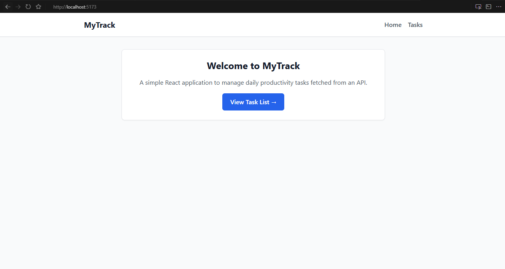
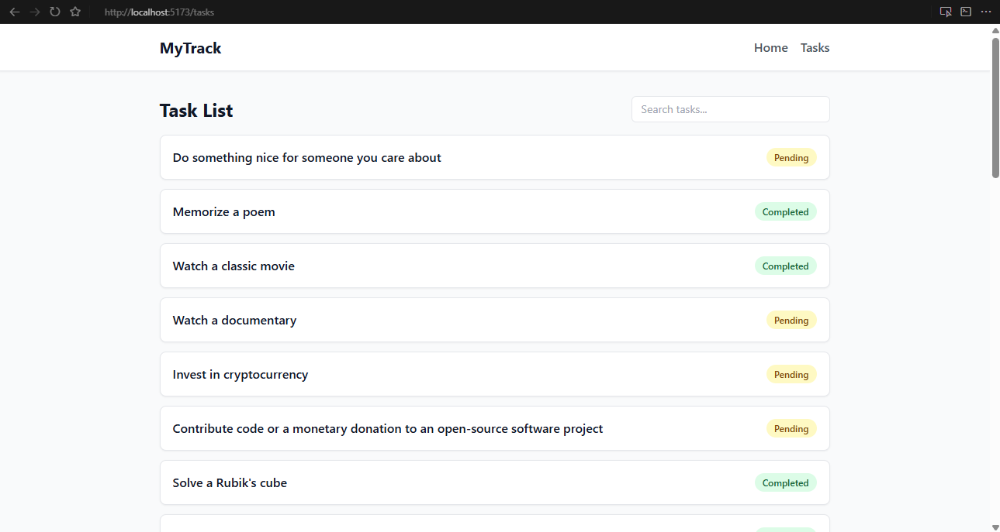
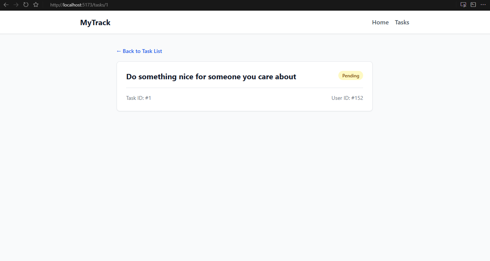

# Mini Project 1 - React Task & Productivity Manager

### MyTrack

MyTrack is responsive React task management application built for the AIM course. It fetches dynamic task data from the public [DummyJSON API](https://dummyjson.com/todos), allowing users to browse tasks, search locally, and view specific task details via dynamic routing.

## Features & Requirements

**3 Routes**: Includes Home (`/`), Task List (`/tasks`), and Dynamic Task Details (`/tasks/:id`).

- `/` — Welcome dashboard and navigation quick links.
- `/tasks` — Displays all tasks with real-time search and status badges.
- `/tasks/:id` — Displays full details for a selected task by ID.

**Public API**: Integrated with the [DummyJSON Todos API] (`https://dummyjson.com/todos`).

**TanStack Query & State Handling**: Uses `@tanstack/react-query` while implementing loading, error, and empty search results.

**Local State (`useState`)**: Client-side task filtering using a controlled search bar input.

**Screenshots**: 

-Home Page

-Task List (with Search & Status Badges)

-Task Details View

## Tech Stack

- **Framework**: React (Vite)
- **Routing**: React Router v6
- **Server State**: TanStack Query (React Query)
- **Styling**: Tailwind CSS

## Setup

1. **Clone the repository:**
   git clone https://github.com/BINS2026/mini-project-app.git

   cd mini-project-app

   npm install

   npm run dev